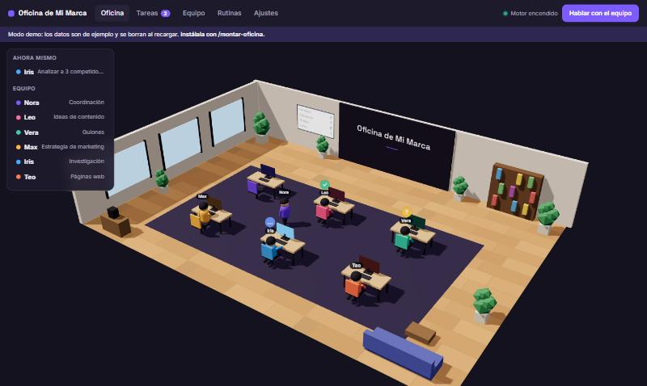

# Oficina de agentes IA

**Tu propio equipo de agentes de IA, cada uno con su nombre y su manual, trabajando en una oficina 3D.** Tú pides, ellos entregan y nada sale sin tu aprobación.



Funciona con Claude Code y tu propio plan de Claude, en tu propia cuenta de Firebase. Sin cuotas de esta plataforma.

## Qué incluye

- **Oficina 3D:** ves quién trabaja, quién tiene una pregunta y quién ya entregó. Toca a un agente para asignarle algo.
- **Tablero de tareas:** Por hacer, Trabajando, Te toca y Lista. Apruebas o pides cambios, y el agente rehace.
- **Equipo:** 9 roles listos y un manual editable por agente. El manual es lo que más cambia la calidad.
- **Coordinador:** le escribes en lenguaje normal y reparte el trabajo entre el equipo.
- **Rutinas:** trabajo que se repite solo (por ejemplo, ideas cada lunes a las 8:00).
- **Telegram (opcional):** pídele cosas desde el celular y recibe avisos.
- **Tu marca:** nombre, color y logo en la app y en la oficina.

## Ver la demo en un minuto

Sin cuentas ni configuración:

```bash
git clone https://github.com/ONEagencia/oficina-agentes-ia.git
cd oficina-agentes-ia
npm install
npm run demo
```

Abre `http://localhost:5173`.

## Instalarla

Necesitas [Node 20.6+](https://nodejs.org), [Git](https://git-scm.com), [Claude Code](https://claude.com/claude-code), un plan de pago de Claude y una cuenta de Google.

La forma más fácil: abre Claude Code en la carpeta donde la quieres guardar y pégale esto:

```
Instálame la oficina de agentes IA de este repositorio:
https://github.com/ONEagencia/oficina-agentes-ia

1. Clónalo en esta carpeta y trabaja dentro de la carpeta oficina-agentes-ia.
2. Lee .claude/skills/montar-oficina/SKILL.md y síguelo de principio a fin, fase por fase.
3. Si me falta algo en la computadora (Node o Git), dime cómo instalarlo y sigue cuando te confirme.

Hazme las preguntas de la entrevista de a poco. No me muestres ninguna clave.
```

Si ya la descargaste, dentro de la carpeta:

```bash
claude
```

Y en Claude Code:

```
/montar-oficina
```

Claude te entrevista, diseña tu equipo, le escribe un manual a cada agente con la información de tu negocio, crea tu proyecto en Firebase, publica tu oficina y se queda contigo hasta ver la primera entrega.

## Cómo funciona

```
Tú (web o Telegram)  →  Firebase (tareas y equipo)  →  Motor en tu computadora  →  Claude Code
```

La app vive en internet y la abres desde cualquier dispositivo. El trabajo lo hace el motor, así que **los agentes trabajan mientras tu computadora esté prendida y el motor encendido**. Lo que pidas con el motor apagado queda en cola.

Comandos del día a día:

| Comando | Para qué |
|---|---|
| `npm run motor` | Enciende a tus agentes |
| `npm run autoarranque` | Hace que el motor arranque solo al iniciar sesión |
| `npm run doctor` | Revisa la instalación y dice qué falta |
| `npm run publicar` | Publica cambios de la app y de las reglas |

Las entregas con archivos quedan en `Oficina IA/entregas` dentro de tu carpeta de usuario.

## Seguridad

- **Cada agente tiene permisos mínimos:** solo escribe en su propia carpeta y no usa la terminal. Internet y otras herramientas se activan por agente.
- **Nada sale de la oficina sin ti:** por defecto, un agente no tiene cómo publicar, enviar mensajes ni gastar dinero.
- **Solo entran tus correos:** las reglas de Firestore limitan el acceso a quienes autorizaste y a la cuenta del motor.
- **Tus claves son tuyas:** viven en `engine/.env`, que nunca se sube al repositorio.

Revisa siempre lo que entrega un agente antes de usarlo. La IA se equivoca, y un agente con internet puede leer páginas con instrucciones maliciosas.

## Lo que cuesta

- **Código:** gratis.
- **Firebase:** el plan gratuito Spark alcanza para una oficina normal.
- **Claude:** los agentes consumen el límite de tu plan. Empieza con tareas cortas y mira cuánto gastan.

## Si algo falla

Corre `npm run doctor`. Si no alcanza, pégale el error a Claude Code dentro de esta carpeta.

## Quién la hizo

Hecha por [ONE Agencia](https://one-agencia.vercel.app). Cuento cómo la uso para crecer una cuenta con IA en [@danielpuentes.one](https://www.instagram.com/danielpuentes.one/).

## Licencia

Es gratis, bajo la [PolyForm Internal Use 1.0.0](LICENSE).

- **Puedes:** instalarla y adaptarla para la operación interna de tu persona o tu empresa.
- **No puedes:** redistribuirla, revenderla, publicar copias ni ofrecerla como producto o servicio a terceros.

¿Quieres usarla de otra forma? Escríbenos.
